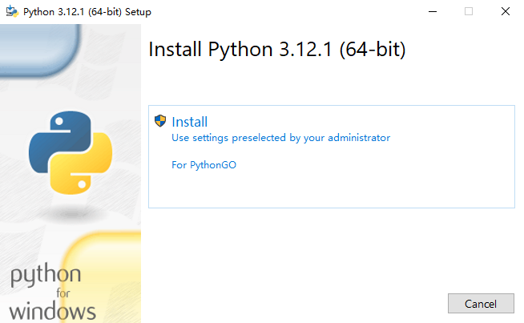

# 安装运行环境

> [!NOTE]
> 使用 PythonGO，需要有编程经验，还需要有一定的英语水平，知道如何编辑 `.py` 文件，能自己解决 Python 安装过程遇到的问题，以及看懂 Python 的报错并解决。

> [!NOTE]
> 现在，你可以自行安装大于等于 Python 3.12 的任意版本，本教程目前只提供 Python 3.12 的安装包。

<a id="download"></a>
### 下载安装包

64 位

对应无限易版本号为 `v2` 开头

下载

32 位

对应无限易版本号为 `v1` 开头

下载

<a id="decompress"></a>
### 解压安装包

将压缩包解压后得到以下五个文件

```text
python3.12
├── python-3.12.*.exe
├── requirements.txt
├── unattend.xml
├── 安装依赖.exe
└── 安装依赖-备用.bat
```

<a id="install"></a>
### 安装 Python

运行 `python-3.12.*.exe`

点击 `Install`



安装完成后如果出现：`Disable path length limit`，请点击该项。

<a id="requirements"></a>
### 安装依赖

双击运行文件夹中的 `安装依赖.exe` 文件，会开始下载并自动安装依赖库

> [!NOTE]
> 如果 360 有报错或提示，请选择：允许该程序所有操作

> [!NOTE]
> 如该程序运行失败（请先确保文件都解压出来了），则运行 `安装依赖-备用.bat`

<a id="enable-pythongo"></a>
### 开启 PythonGO 功能

运行环境安装完成之后，还需要进行最后一步，去无限易客户端开启 PythonGO 功能，具体操作如下：

1. 打开无限易客户端并登录
2. 点击上方菜单栏「量化 - PythonGO」
3. 将「策略引擎」开关打开
4. 点击设置 ⚙️ 按钮，确认 Python 版本已经被正确识别并选中，可自行选择自己想使用的版本
