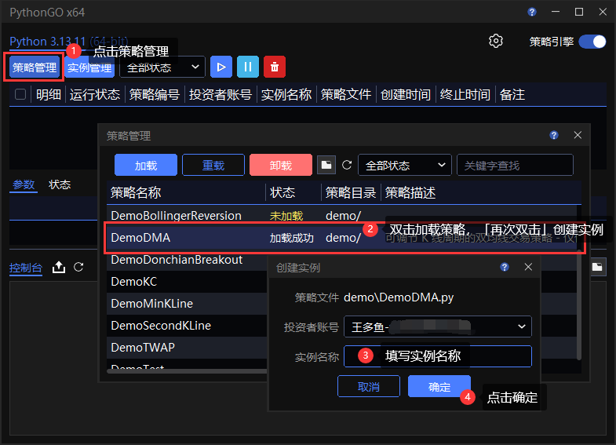
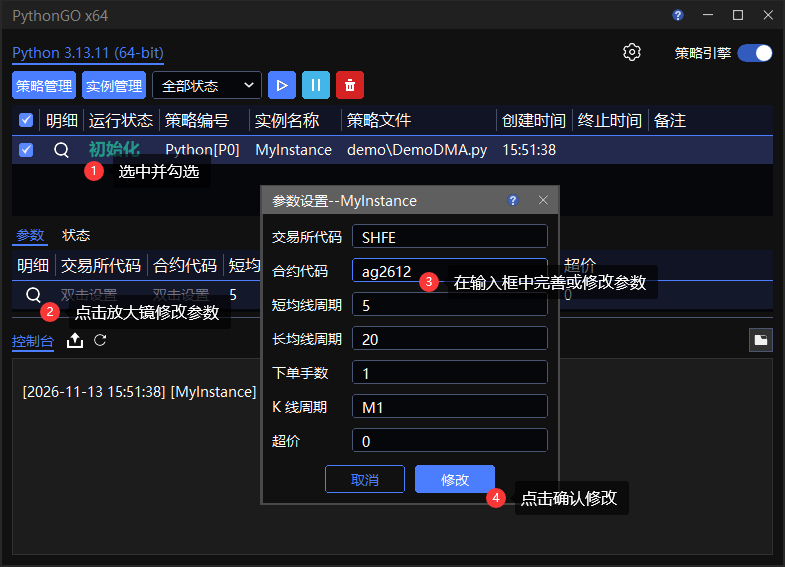
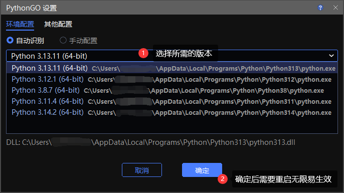
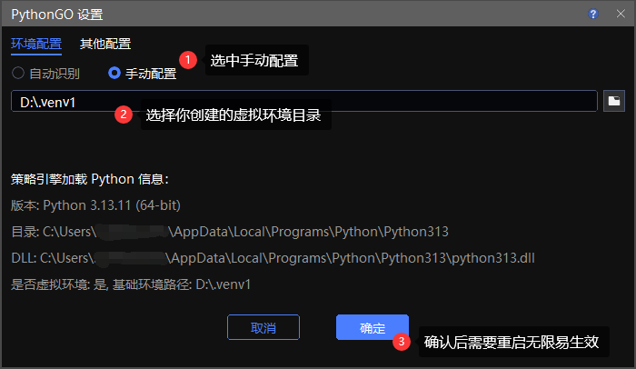

# 操作入门

本章节讲解安装好 PythonGO 运行环境并启用 PythonGO 功能后，如何加载并使用 PythonGO 自带的策略，以及一些其他的操作，让你走上使用 PythonGO 的第一步。

首先需要知道的是，PythonGO 只能在无限易客户端中使用，无法单独使用编辑器调试或运行，这是因为 PythonGO 的所有数据（行情数据，合约数据等...），都来自于无限易客户端，无限易客户端通过程序接口将这些数据传送给 PythonGO，PythonGO 拿到这些数据后，才能根据策略代码的逻辑来执行并达到我们想要的效果，所以 PythonGO 依赖于无限易客户端，无法单独运行。

<a id="start-strategy"></a>
## 运行策略

点击上方菜单栏「量化 - PythonGO」打开 PythonGO 窗口

<a id="load-strategy"></a>
### 加载策略

每个策略文件都是一个策略，我们要使用这个策略，首先需要加载它，可以理解为 Python 中的 `import` 操作，而实例是通过策略创建出来的，每个策略可以创建 N 个实例，可以理解为 Python 中的「实例化」操作

1. 点击「策略管理」按钮
2. 在弹出的策略管理窗口中找到我们想加载的策略
3. 双击该策略完成加载，当「状态」变更为「加载成功」后，**再次双击**该策略「创建实例」
4. 在弹出的创建实例窗口中的「实例名称」一栏中，填入任意名称，该值是唯一的，不可重复
5. 点击「确定」按钮，实例会出现在主界面表格中，状态为「初始化」

如果状态栏显示「加载失败」，大多数情况下都是没有正确安装依赖导致的，可以根据控制台的报错信息来查阅以下文档内容排查并解决问题：

- [安装文档](../python_install.md)
- [问题汇总 - 安装问题](../faq/install.md)



<a id="fill-params"></a>
### 填写参数

创建实例之后，我们还需要填写需要传入对应的参数，可以理解为 Python 中的「给变量赋值」操作

> [!CAUTION]
> 注意：**交易所**和**合约代码**必须以无限易「实时行情」窗口的字段「交易所」和「合约代码」为准，因为交易所对合约的命名规则是不一样的，而在 PythonGO 中，交易所代码和合约代码是严格区分大小写的，所以请务必以无限易显示的字段为准。

> [!CAUTION]
> 注意：如果要查询期权的**合约代码**和**品种代码**，必须以无限易「期权 - T 型报价」窗口期权合约列的字段「合约代码」和「品种」为准。

> [!CAUTION]
> 注意：合约代码不能直接填主连合约代码，例如 `agMain`，这是无效的合约代码。

1. 点击放大镜填写或修改参数（也可以直接双击参数表格中的值来完成填写或修改）
2. 如果策略中需要填写交易所和合约，请按上述提示在无限易中找到对应字段并填写
3. 点击「修改」按钮
4. 修改完成且成功后，我们可以点击  按钮来运行我们的策略实例



- 如果需要暂停，可以点击 
- 删除实例点击 

<a id="reload-strategy"></a>
## 重载策略

当你修改了策略文件的代码，是需要重新加载该策略的，否则修改后的代码不会生效。点击「策略管理」按钮，在策略管理窗口中「单击」准备重新加载的策略，点击「重载」按钮，即可完成重新加载。

<a id="quickly-load-instance"></a>
## 快速加载实例

当我们创建好实例后，也正常运行了，运行之后有点击暂停实例，这个时候实例的参数信息会被保存到一个 `JSON` 文件，等下一次我们想再加载这个实例的时候，就可以省略加载策略的步骤，直接加载实例了。

点击「实例管理」按钮，有以下两种方法快速加载实例：

- 在弹出的实例管理窗口中「双击」想快速加载的实例即可完成加载
- **或者也可以**「单击」勾选多个实例后，点击「加载」按钮完成多个实例的快速加载

> [!NOTE]
> 注意：实例运行后需要点击暂停按钮并确认 `on_stop` 被调用才会保存实例参数，后续每次保存会覆盖之前的参数；实例管理界面只会显示未加载的实例，已经加载的实例不会重复展示。

<a id="切换-python-版本"></a>
## 切换 Python 版本

如果我们电脑上安装了多个 Python 版本，并且想指定一个专门的版本给 PythonGO 使用，那么现在可以非常方便地进行切换。

点击 PythonGO 界面的设置 ⚙️ 按钮，在下拉框选择自己电脑上已经正常安装的 Python 版本即可，选择后，点击确定，新的 Python 版本在重启无限易后生效。

> [!NOTE]
> 注意：选择新的 Python 版本后，你可能需要重新安装依赖。



<a id="使用虚拟环境"></a>
## 使用虚拟环境

新增支持多版本 Python 切换后，我们也顺带加入了虚拟环境的支持。

目前支持 Python 的原生 [`venv`](https://docs.python.org/zh-cn/3/library/venv.html) 模块创建的虚拟环境，你可以使用以下命令创建一个虚拟环境，该环境独立运行，不会影响主 Python 环境和其他虚拟环境。

```bash
python -m venv 你指定的虚拟环境目录名
```

创建好虚拟环境目录后，或者你有自己的虚拟环境目录了，就可以在 Python 设置界面进行设置。选中「手动配置」，然后点击「文件夹」按钮选择对应的虚拟环境目录即可。确认并重启后，就可以开始使用完全独立的虚拟环境了。

> [!NOTE]
> 注意：虚拟环境需要使用环境中的 Python 来安装依赖，具体请网上搜索对应教程。


